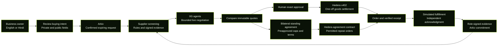

<div align="center">


# Perenna

### Business moves smarter.

**Tell your agent what your business needs. Keep authority over every commitment.**

English and Hindi procurement, live supplier negotiation, and bounded testnet settlement.


[What it does](#what-it-does) · [How it works](#how-it-works) · [Get started](#get-started) · [Try a procurement](#try-a-procurement) · [Current status](#current-status)

</div>

---

## What it does

Perenna represents a small business through its procurement workflow: capture a buying request, screen fictional suppliers against real rules, negotiate structured offers, review exact terms, and track settlement and fulfillment separately. Every page shares a black and neon-green Three.js world with original robot agents and accessible controls.

<table>
<tr>
<td width="50%">

### Say what your business needs

Use English or Hindi voice and text. Correct the transcript, clarify missing fields, and review quantity, specification, budget, place and delivery time before publication.

</td>
<td width="50%">

### Compare actual trade-offs

Screen suppliers by credibility, availability and delivery rules. Observe agent turns, discuss an offer privately, and rank eligible quotes by price, delivery and credibility.

</td>
</tr>
<tr>
<td>

### Approve the exact deal

Review immutable quote versions, fees, payee and spending limits. Changed terms invalidate approval. Payment, supplier acknowledgment and physical fulfillment remain separate facts.

</td>
<td>

### Authorize repeat buying with limits

A bilateral standing agreement freezes products, prices, cadence, delivery rules, wallets and cumulative caps. Disputes, revocation and policy breaches stop further execution.

</td>
</tr>
</table>

> **Development MVP:** the full local checkpoint passed **305 automated tests and 82 desktop/mobile browser checks**. Earlier live 0G inference, Hedera settlement and Arkiv records are retained. The latest original and alternate native 0G routes returned HTTP 502, so a fresh live negotiation is currently blocked. Suppliers are fictional and physical delivery is explicitly simulated.

## How it works



**Agents propose. Deterministic rules authorize.** Model output cannot raise caps, sign a wallet transaction or approve changed purchase terms.

A separate useful x402 service request can run without approval at request time only under a previously signed operating policy. Its funds and ledger are separate from goods purchases. Hedera test tokens do not automatically fund 0G inference.

| Layer | Responsibility |
| --- | --- |
| Next.js, React and Three.js | Eight responsive spatial pages, English/Hindi controls, review and recovery |
| Node.js worker and SQLite | Durable jobs, tenant and room authorization, immutable records, budgets and reconciliation |
| 0G | Intent interpretation and supplier/buyer proposals with request references and bounded usage |
| Arkiv Rabdi | Minimal public requests, proposed agreement indexes and signed outcome commitments |
| Hedera testnet | x402 goods/service settlement and bounded standing-agreement contract execution |
| Sarvam | English/Hindi transcription and synthesis; text remains available |
| Groq | Explicitly configured fallback adapter; no live fallback inference has been verified |

## Get started

### 1. Install and configure

Use **Node.js 24** and npm. The current development setup is Windows PowerShell; use `npm.cmd` if script execution blocks `npm.ps1`.

```powershell
git clone https://github.com/DarshanKrishna-DK/Perenna.git
cd Perenna
npm.cmd ci

# Create the private configuration only when it does not already exist.
if (-not (Test-Path -LiteralPath .env.local)) {
    Copy-Item -LiteralPath .env.example -Destination .env.local
}
```

Configure only the providers you intend to exercise. Secrets stay in `.env.local`; the template contains names and paused execution defaults. The interface and manual drafts can be reviewed locally, while live inference, publication and settlement require configured services and explicit budgets. Use the [manual setup guide](docs/04_Perenna_Manual_Setup_Guide.md) for wallet roles, approved limits and current owner actions.

### 2. Open the application

```powershell
npm.cmd run dev
```

Open **http://127.0.0.1:3000**. Create a business workspace, choose English or Hindi, and review its permissions and separate goods/operating caps. Stop the local server when it is no longer needed.

### 3. Check the worker before executing work

```powershell
npm.cmd run worker -- --check
```

This initializes and checks storage, then exits without executing jobs. Start `npm.cmd run worker` separately only when provider budgets, execution flags and signed policies permit the intended work. The server and worker must use the same private SQLite database.

For a production preview, stop the development server, run `npm.cmd run build`, then `npm.cmd run start`.

## Try a procurement

> I need 50 kg of coffee beans delivered to Mumbai within seven days. My total budget is 25000 INR.

> मुझे सात दिनों के भीतर मुंबई में 50 किलो कॉफी बीन्स चाहिए। मेरा कुल बजट 25000 भारतीय रुपये है।

1. Capture the request, correct its transcript and confirm the structured fields.
2. Review the minimal public projection, private details, request expiry and configured caps.
3. Publish on Arkiv, confirm the reference, and refresh supplier screening.
4. Run live negotiation with an available provider and remaining authorized calls.
5. Compare eligible offers, inspect revisions and discuss a supplier's own quote privately.
6. Approve one exact current offer, then use its separately authorized testnet settlement path.
7. Track acknowledgment, intentional fulfillment simulation and attributable evidence.

For recurring procurement, propose complete standing terms, obtain both parties' authority and fund only the reviewed contract allowance. Matching repeat orders use that prior authority; a changed price or dispute can stop them.

**To review the retained demo:** use the private local account described in `.data/live-mvp-client.json`. The saved workspace contains published requests, quote history, three confirmed orders, signed evidence and standing-agreement history. Select the older purchased request to review the successful negotiation. Historical records stay labeled as history; they are not replayed as new live activity.

## Current status

| Area | Evidence and current boundary |
| --- | --- |
| Spatial interface | All eight pages exercised on desktop/mobile, with WebGL, reduced motion, no horizontal overflow and automated accessibility checks |
| Business participation | Owner/member consent, supplier invitations, scoped private rooms, quote submission and revocation exercised in controlled browser workflows |
| English and Hindi | Actual Sarvam round trips retained; the owner confirmed microphone capture and editable transcripts; personal speaker playback remains separate |
| Live 0G | Earlier English/Hindi parsing, three-supplier negotiation and a private revision succeeded; latest original and approved alternate native routes returned HTTP 502 |
| Hedera x402 | Historical autonomous service, exact goods and separately authorized supplier-fee receipts verified on testnet |
| Standing agreements | Contract activation, two autonomous purchases, dispute stop, revocation and withdrawal verified; expanded identity/receipt-authority controls have regression coverage |
| Arkiv | Six approved writes confirmed and read back, including a proposed standing-discovery listing returned by the application API |
| Data and recovery | Persistent workspaces, cursor replay, exact approvals, unknown-outcome reconciliation and session-expiry clearing verified |
| Public release | Source repository and local MVP; no hosted application deployment or event submission |

The retained operator has **28 recorded inference attempts against 30 approved**, with two unused. All six authorized Arkiv writes are consumed. Inference, public-write and financial execution remain paused. Do not reset local journals to regain an allowance. Exact 0G charges and remaining credit balance are unverified. Public transaction references and detailed limits are in [prize evidence](docs/prize-evidence.md).

<details>
<summary><strong>Operational boundaries</strong></summary>

- Businesses, inventory and seeded histories are fictional fixtures. Real-business sign-in does not establish legal identity or KYC.
- Physical delivery and dispute events are simulated. A signature proves who made a statement, not that goods arrived.
- x402 settlement does not provide escrow, refunds or physical fulfillment guarantees.
- This single-host demo uses operator-managed test wallets across isolated business workspaces. It is not production multi-customer custody.
- Goods, operating services and supplier fees have distinct roles, authorization and ledger treatment. A goods receipt alone does not establish collected fee revenue.
- INR quote amounts use an explicit testnet demonstration denomination, not a live exchange rate.
- No earned-fee-to-0G conversion, automatic mainnet bridging, swaps, purchases or top-ups are established.
- `ARKIV_DISCOVERY_MODE=local_sample` is an explicit test mode with visible provenance. It is not proof of live Arkiv publication.
- Wallet-extension signing remains separate from tested wallet rejection and retained server-authorized testnet transactions.

</details>

## Build and verify

```powershell
npm.cmd run typecheck
npm.cmd test
npm.cmd run build
```

Type checking first generates Next.js declarations, which are local generated files. The last full checkpoint contains 305 automated tests and 82 guarded browser checks. These counts are dated verification evidence, not a live CI badge or a claim of provider availability.

<details>
<summary><strong>Guarded desktop/mobile browser checks</strong></summary>

Use a separate local-sample database and port, rather than the retained live workspace. Start this test server in one terminal:

```powershell
$env:ARKIV_DISCOVERY_MODE = 'local_sample'
$env:PERENNA_DB_PATH = Join-Path $PWD '.data/browser-acceptance.sqlite'
npm.cmd run dev -- --port 3001
```

Run the suite from another terminal:

```powershell
$env:PERENNA_BASE_URL = 'http://127.0.0.1:3001'
npx.cmd playwright test -c tests/browser/playwright.config.ts
```

The suite blocks unmocked inference, payments and public writes. It uses a separate headless browser, not a personal Chrome profile. Chrome's Windows executable path is the default; set `PERENNA_CHROME_PATH` if it is installed elsewhere. Stop the test server afterward. The browser report remains local under `artifacts/browser/`.

</details>

<details>
<summary><strong>Project map and documentation</strong></summary>

```text
src/
  app/             Pages, API routes and shared spatial styling
  components/      Business, procurement, agreements, funds and voice controls
  domain/          Deterministic validation, normalization, ranking and money rules
  server/          Persistent workflows, authorization, worker and accounting
  providers/       0G, Arkiv, Hedera, Sarvam and optional Groq adapters
  i18n/            English/Hindi localization
contracts/         Bounded standing-procurement contract
tests/             Source regressions and guarded browser checks
scripts/           Reviewed estimation, preparation and execution utilities
public/            Canonical product logo, local fonts and their licenses
docs/              Product specification, setup, architecture plan and evidence
.env.example       Configuration names without live credentials
TODO.md            One-line completed and remaining work
```

Read the [MVP specification](docs/02_Perenna_MVP_Build_Specification.md), [architecture and requirement audit](docs/05_MVP_Parallel_Agent_Plan.md), [design system](DESIGN.md), [official source register](docs/sources.md) and [manual guide](docs/04_Perenna_Manual_Setup_Guide.md).

Credentials, databases, budget journals, generated declarations, build caches, machine-specific MCP reports and test output are excluded from Git. Source tests, specifications, lockfile and license notices remain versioned. Moving to a different folder or account requires preserving private state and starting a new Codex goal from the checklist; copying files does not transfer the conversation's goal state.

</details>

---

<div align="center">

**Perenna · Business moves smarter.**

[MIT License](LICENSE) · [Documentation](docs/README.md) · [Progress](TODO.md)

Source developed with AI assistance. Product artwork supplied by the owner. Local fonts retain their included licenses.

</div>
